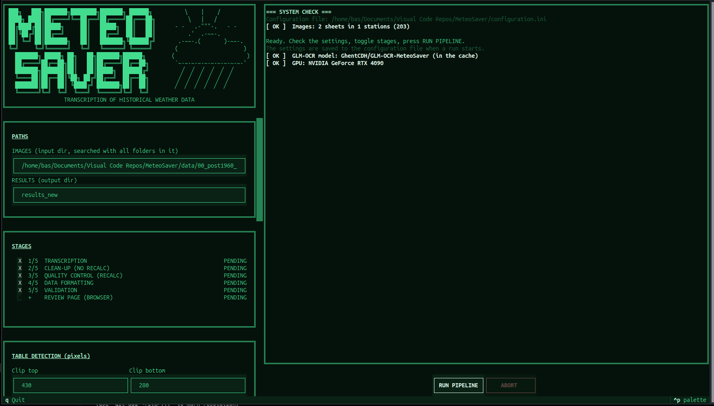

# MeteoSaver

MeteoSaver transcribes handwritten historical weather data sheets into
structured hydroclimate data. It detects tables and cells in scanned sheets,
reads the cells with an OCR/HTR model, applies QA/QC checks, and can format
the results for analysis or upload.

## Quick start

### 1. Install the environment

MeteoSaver is tested with Python 3.12 and uses [uv](https://docs.astral.sh/uv/)
to create and manage its environment. Install uv first, then run this from
the repository root:

```bash
uv sync
```

This creates `.venv` and installs the locked dependencies from `uv.lock`.

### 2. Configure an input run

Open [`configuration.ini`](configuration.ini) and update the settings for
your data. At minimum, check:

- `[General]`: use `local` for sequential processing on a computer, or
  `hpc` for multiprocessing on a cluster.
- `[Directories]`: set `full_datadir` to the directory containing the sheet
  images and set the input/output and metadata paths. Image files can be
  nested in station folders; supported extensions include `.jpg`, `.jpeg`,
  `.png`, `.tif`, `.tiff`, and `.bmp`.
- `[TableAndCellDetection]`: adjust clipping, table dimensions, cell
  dimensions, and the expected row and column counts for your sheet layout.
- `[Transcription]`: select the OCR/HTR model and set its model-specific
  options.
- `[QAQC]` and `[DataFormatting]`: adjust the columns, thresholds, sheet
  layout, and date settings for your data.

Paths are interpreted from the directory in which the command is run, so run
MeteoSaver from the repository root or use absolute paths. The checked-in
configuration is an example for the sample data in `data/`; its
`full_datadir` is machine-specific and should be changed on another
computer.

### 3. Start the dashboard

The terminal dashboard is the easiest way to run MeteoSaver:

```bash
uv run meteosaver
```

The dashboard lets you review the most important settings, choose the stages
to run, start the pipeline, and follow its progress and log output. It writes
the dashboard settings back to the configuration file when a run starts.
Settings not shown in the dashboard must still be edited in
[`configuration.ini`](configuration.ini).




To use a different configuration file:

```bash
uv run meteosaver --config /path/to/my-configuration.ini
```

The equivalent command, useful when the editable script entry point is not
available, is:

```bash
uv run python src/tui.py
```

## Run without the dashboard

The pipeline can also be started directly:

```bash
uv run python src/main.py
```

By default this runs transcription, clean-up, quality control, data
formatting, and validation. The review-page stage is opt-in. Select a subset
of stages with `--stages`:

```bash
uv run python src/main.py --stages transcription cleanup qaqc formatting
uv run python src/main.py --stages qaqc formatting validation
```

Available stages are:

| Stage             | What it does                                                                                                                           |
| ----------------- | -------------------------------------------------------------------------------------------------------------------------------------- |
| `transcription` | Preprocesses each sheet, detects tables/cells, and transcribes the cells.                                                              |
| `cleanup`       | Normalizes transcribed values and performs single-value checks; it does not recalculate values.                                        |
| `qaqc`          | Runs clean-up plus cross-checks that recalculate and confirm values, such as totals, averages, and temperature relationships.          |
| `formatting`    | Uses the checked values to create final time-series outputs, including Excel and Station Exchange Format (SEF) files where configured. |
| `validation`    | Compares MeteoSaver output with manually transcribed data when it is available.                                                        |
| `review`        | Writes a browser review page for each sheet; it is not selected by default and requires GLM-OCR.                                       |

Stages that are omitted use files already present in the configured result
directories. Run `qaqc` rather than `cleanup` when you want the recalculating
cross-checks; `qaqc` includes clean-up.

### Using another configuration with the pipeline

`src/main.py` reads `configuration.ini` by default. To use another file,
set `METEOSAVER_CONFIG`:

```bash
METEOSAVER_CONFIG=/path/to/my-configuration.ini \
  uv run python src/main.py --stages transcription qaqc formatting
```

The dashboard’s `--config` option and the pipeline’s `METEOSAVER_CONFIG`
environment variable are separate mechanisms.

## OCR/HTR requirements

The default model is GLM-OCR:

```ini
[Transcription]
ocr_model = GLM-OCR
glm_model = GhentCDH/GLM-OCR-MeteoSaver
```

The model is downloaded from Hugging Face on first use (approximately 2.2 GB)
and cached locally. A GPU is strongly recommended. Reduce `glm_batch_size` if
the model runs out of GPU memory. On an HPC system, `glm_python` can point to
a separate Python environment containing the GLM-OCR dependencies.

Tesseract is an alternative, but the Tesseract executable is not a Python
dependency. Install it separately, copy the required trained data file from
[`OCR_HTR_models/`](OCR_HTR_models/) into the system `tessdata` directory,
and set `tesseract_path` and `system_tessdata_dir` in the configuration.

## Outputs

The configured output directories are created and populated as stages run.
The sample configuration uses these locations:

- `results_new/01_pre_QA_QC_transcribed_hydroclimate_data/`: raw
  transcription output.
- `results_new/02_post_QA_QC_transcribed_hydroclimate_data/`: output after
  QA/QC.
- `results_new/03_validation_transcibed_data/`: validation comparisons.
- `results_new/04_final_refined_daily_hydroclimate_data/`: formatted final
  data.
- `results_new/05_transient_transcription_output/`: intermediate processing
  files.
- `results_new/08_GLM_OCR_output/`: text read by GLM-OCR and detected cells.
- `results_new/09_review_pages/`: browser review pages when `review` is run.

The dashboard opens the first review page in a browser when that stage is
enabled. Without the dashboard, open the generated `index.html` files
manually.

## Sample data and examples

The repository includes sample sheet images under
[`data/00_post1960_DRC_hydroclimate_datasheet_images/`](data/00_post1960_DRC_hydroclimate_datasheet_images/)
and notebooks and a minimal working example under
[`manual_and_minimal_working_example/`](manual_and_minimal_working_example/).
The example configuration is designed for the included sample data, but
machine-specific paths still need to be updated.

## Project structure

- [`src/main.py`](src/main.py): command-line pipeline.
- [`src/tui.py`](src/tui.py): terminal dashboard entry point.
- [`src/meteosaver_app/`](src/meteosaver_app/): dashboard implementation and
  pipeline runner.
- [`src/image_preprocessing_module.py`](src/image_preprocessing_module.py):
  image preprocessing.
- [`src/table_and_cell_detection_model.py`](src/table_and_cell_detection_model.py):
  table and cell detection.
- [`src/transcription.py`](src/transcription.py): OCR/HTR transcription.
- [`src/quality_assessment_and_quality_control.py`](src/quality_assessment_and_quality_control.py):
  clean-up and QA/QC.
- [`src/data_formatting_and_upload.py`](src/data_formatting_and_upload.py):
  final formatting and export.
- [`src/validation.py`](src/validation.py): comparison with manual
  transcriptions.
- [`docs/`](docs/): workflow diagrams and data-formatting references.

## License and authors

MeteoSaver is released under the license in [`LICENSE`](LICENSE).

Authors:

- Derrick Muheki
- Koen Hufkens
- Bas Vercruysse
- Krishna Kumar Thirukokaranam Chandrasekar
- Wim Thiery
